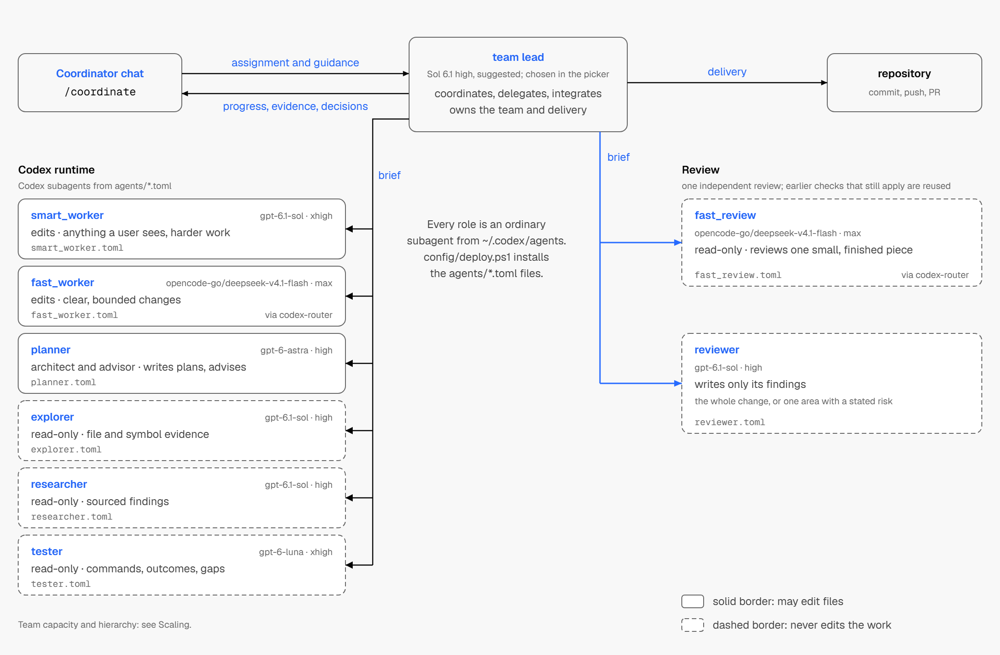
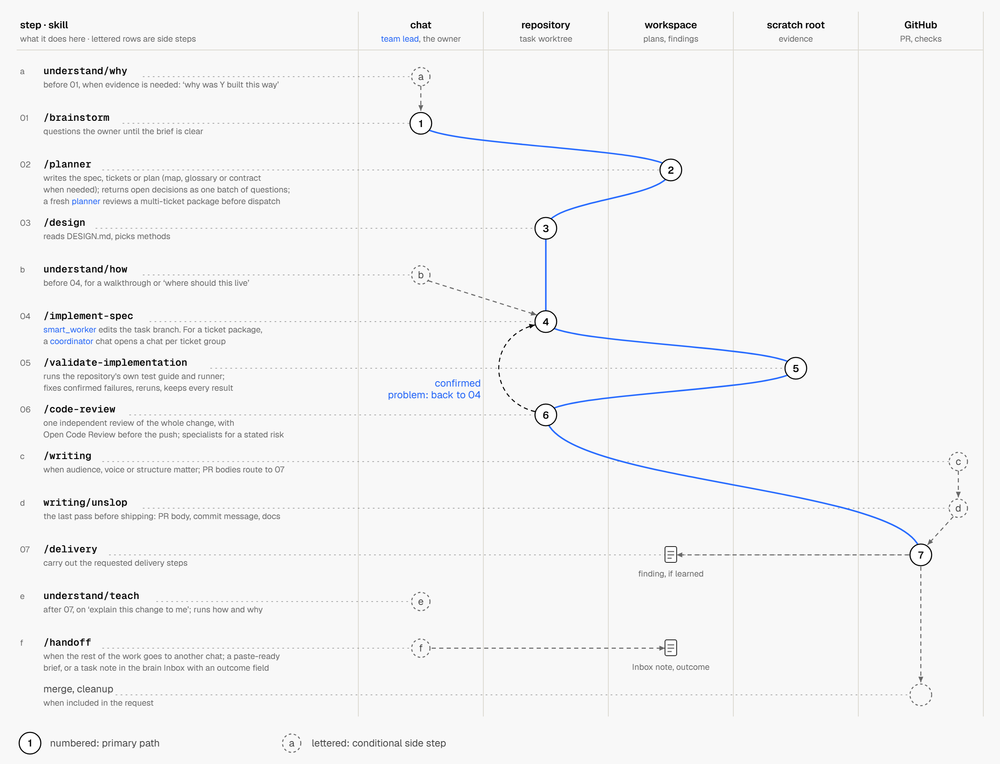

# Agent harness

A versioned set of user-level instructions, agent roles and method skills for
Codex and Claude Code. One source deploys to both runtimes, so every project on
a machine gets the same way of working: how to read a request, who does what,
how work is planned, built, reviewed and delivered, and when to stop and ask.

**Agents:** to install this harness, follow [SETUP.md](SETUP.md).

**Website:** [kitchen.plynth.ai](https://kitchen.plynth.ai/) explains the
harness in pictures, starting with
[How it works](https://kitchen.plynth.ai/explore/how-it-works/).

This is a public copy of a working harness. It is published as a snapshot: each
update arrives as one commit, and issues and pull requests are not reviewed.

## How it works

### Who does what

<picture>
  <source media="(prefers-color-scheme: dark)" srcset="images/roles-dark.png">
  
</picture>

Each role is one file in `agents/`. Claude Code runs the same roles from the
same files on Claude models.

### From request to reviewed work

<picture>
  <source media="(prefers-color-scheme: dark)" srcset="images/journey-dark.png">
  
</picture>

A task uses only the stages it needs, and delivery goes only as far as you
asked. The website covers the rest: installing, review, quality gates, tools,
documents and adoption.

## What is inside

| Path | What it is |
|---|---|
| `AGENTS.md` | The shared policy and router, loaded into every session |
| `AGENTS.private.example.md` | A template for your own section 01: who you are, your machine, your personal tools |
| `agents/` | Role definitions (team lead, workers, explorer, researcher, planner, tester, reviewers) |
| `skills/` | Method skills, grouped by stage; each entrypoint routes to nested methods so the first prompt stays small |
| `principles-and-patterns/` | The library reviews check work against, read through one generated index |
| `hooks/` | Session hooks, such as reloading skill and task state after a context compaction |
| `config/` | The install map, the deploy script and Open Code Review's house rules |
| `claude/` | The Claude Code adapter: role generation, the user-level `CLAUDE.md` and the sync script |
| `harness-docs/`, `harness-docs-starter/`, `templates/` | How the harness works, and starters for a project's own documents |
| `checks/` | The harness's own checks; `checks/run-all.ps1` runs them |

## Installing it

Point your coding agent, Codex or Claude Code, at this repository and ask it
to set the harness up. It follows [SETUP.md](SETUP.md): it asks you a few
questions first (who you are, which agents you use), installs for those
runtimes and checks the result. The same page works as a manual guide. It runs
on Windows, macOS and Linux with git, Node.js 24 and PowerShell 7.

Read [ARCHITECTURE.md](ARCHITECTURE.md) before changing how the harness behaves,
and [harness-docs/](harness-docs/index.md) for how its parts fit together.

## Credits

Many methods are adapted from other people's published work. Each source, its
revision and its licence are listed in
[THIRD_PARTY_NOTICES.md](THIRD_PARTY_NOTICES.md).

## Licence

MIT, in [LICENSE](LICENSE). Adapted third-party material keeps its own licence,
listed in [THIRD_PARTY_NOTICES.md](THIRD_PARTY_NOTICES.md).
