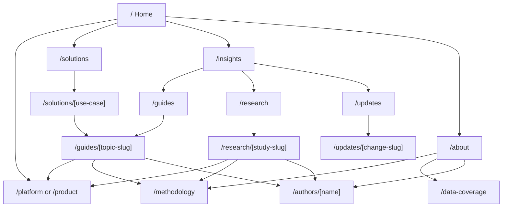
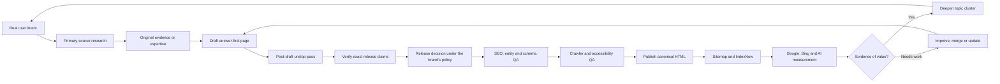

# SEO/AEO content authoring reference guide

The detailed standard behind the authoring route and the weekly programme.
Carried into the harness on 30 September 2026 from a project website's guide
(external guidance rechecked 12 August 2026; source-to-insight, research and
GIS additions reviewed 24 and 26 August 2026). Brand-specific rules moved to
the brand recipes. Spelling follows the project's voice guide.

**Implementation assumptions.** The CMS or framework, rendering architecture,
analytics stack, consent platform and policy on AI-training crawlers are the
project's. This guide defines the **published output**; adapt implementation to
the actual stack.

Bracketed IDs such as [S1] cite the sources listed at the end.

## Executive summary

Google's current position matters: **AEO and GEO are not a separate
optimisation system from SEO.** AI Overviews and AI Mode are grounded in
Google's existing Search index and ranking and quality systems, using
retrieval-augmented generation and query fan-out [S1]. The practical goal is to
make content **valuable enough to rank, clear enough to retrieve, trustworthy
enough to cite, and distinctive enough to recommend**.

### Priority model

| Priority | Pattern | Author rule |
|---|---|---|
| **P0** | Original, non-commodity information | Publish something the open web does not already contain: proprietary data, expert interpretation, worked examples, benchmarks, product evidence or first-hand experience. Google names this the most important long-term content factor for generative search [S1]. |
| **P0** | Satisfy one real intent | Each URL solves a recognisable task or question rather than targeting a keyword variation. Do not create one page for every fan-out query [S1]. |
| **P0** | Crawlable canonical HTML | Important text, links and evidence must be accessible to search engines and AI retrieval systems. Google AI visibility still depends on normal Search indexing and snippet eligibility [S1][S5]. |
| **P0** | Verifiable claims | Put evidence beside important factual claims; identify source, date, jurisdiction or method, and limitations. Bing recommends examples, data and cited sources for AI-reference quality [S10]. |
| **P0** | Clear entity identity | Use consistent product, company, author and feature names across visible text, metadata, schema and media [S3][S10]. |
| **P1** | Answer-first structure | Give the useful answer before background; use descriptive H2 and H3 headings, short sections, lists and tables where the information naturally fits them. Microsoft recommends these formats for AI retrieval, while Google says artificial "chunking" is unnecessary [S1][S9]. |
| **P1** | Strong authorship and provenance | Show the author, credentials where relevant, dates and methodology. Google recommends author-identifying URLs and ProfilePage markup for internal author pages [S3]. Who else is named (a reviewer, say) is the brand recipe's policy. |
| **P1** | Freshness as a system | Update genuinely time-sensitive information, use accurate `dateModified` and `lastmod`, and notify Bing through IndexNow. Never manufacture freshness by changing dates without substantive edits [S3][S11]. |
| **P1** | Agent-friendly semantics | Real links, buttons, labels and accessible states make pages easier for browser agents as well as people [S12]. |
| **P2** | Structured data | Add accurate schema to describe entities and qualify for supported Search features; **do not treat schema as an AI-citation hack**. Google says there is no special AI schema, and a 2026 Ahrefs intervention study found no material citation gain from adding JSON-LD to already-cited pages [S1][S14]. |
| **P2** | `llms.txt` | Optional and experimental. Google ignores it for Search and says it neither helps nor hurts rankings [S1]. |

### The operating principle

> **Write for a knowledgeable human; structure for reliable retrieval;
> substantiate for citation; publish unique evidence for recommendation.**

Do **not** optimise for a mythical "AI word count", a keyword-density target,
tiny content chunks, hidden AI metadata or mass-produced FAQ variants. Google
rejects those approaches as unnecessary for generative Search [S1].

On-site work raises the probability that a page is discovered and cited; it
cannot guarantee that ChatGPT, Claude, Gemini or Copilot will recommend the
brand. AI systems also draw on third-party sources about products and
services, so genuine external reputation and corroboration still matter.
Google warns against manufacturing inauthentic mentions [S1].

## Authoring patterns, writing style and content templates

### Writing standard

**Every page**

- **State the answer early.** The first substantive paragraph tells the reader
  what the page establishes; do not spend 300 words framing the question.
  Recent large-scale observational research associates clear summaries and
  section structure with AI-cited content [S15].
- **Make headings informative.** Prefer `How floor space ratio is calculated
  in NSW` over `Understanding FSR`.
- **One section, one coherent question or task.** Keep related material
  together; do not split every sentence into "AI chunks" [S1].
- **Prefer specific nouns to vague references.** `The Environmental Planning
  Instrument sets...` is easier to interpret than `It sets...` when a section
  could be retrieved on its own.
- **Use measurable language.** Replace `very fast`, `innovative`, `leading` or
  `advanced` with an observable capability, number, method or comparison
  [S9].
- **Answer before selling.** A guide stays useful if every call to action
  disappears.
- **Use Q&A selectively.** Direct question-and-answer structure helps when
  users genuinely ask the question [S9]. Do not turn every heading into a
  contrived FAQ.
- **Use tables for actual comparisons.** Specifications, eligibility criteria,
  alternatives and decision matrices keep relationships explicit [S9].
- **Keep important information visible.** Never put the only copy of the
  answer inside an image, PDF, animation, hover state or collapsed interface
  [S9].
- **Give guides a meaningful visual.** A published guide gets a visual summary
  and at least one article-native diagram, decision tree, annotated specimen,
  calculation or comparable evidence graphic. The visible text still carries
  the answer.
- **Use real product screenshots for product workflows.** A page that teaches
  a current product workflow uses current, release-matched screenshots or an
  annotated sequence once they exist. Verify the state against the release,
  label limitations and replace stale captures when the workflow changes.
  Until then, use an accurate native process diagram and track the screenshot
  work; never fabricate product UI or present a mock-up as live behaviour.
- **Use the terms users and the domain actually use.** Synonyms and related
  concepts can appear naturally; Google does not require exact-match long-tail
  phrasing [S1].
- **No arbitrary word-count target.** Length follows the information the intent
  needs; Google says there is no ideal length for generative Search [S1].
- **Prefer "we" and "our"** once the organisation is established as author or
  analyst, and do not repeat the brand name in headings or body copy for
  keyword reinforcement.

### Reusable content templates

| Page type | Recommended sequence | Original-evidence requirement |
|---|---|---|
| **Product capability** | H1 → one-sentence capability → who it is for → how it works → inputs and outputs → evidence or specimen → limitations → integrations and workflow → security and data notes → related methodology → call to action | Screenshot with real output, annotated workflow, measured performance, example input and output, or documented methodology |
| **Evergreen guide** | H1 → direct answer → scope and jurisdiction → definitions → how it works → worked example → exceptions → primary sources → related questions → author → review date | Original example, decision tree, annotated source, calculation, map or expert interpretation |
| **Comparison or decision** | H1 → decision summary → comparison criteria → table → trade-offs → who each option suits → methodology → evidence → conclusion | Original testing, transparent scoring method, first-hand evaluation or factual feature verification |
| **Research or data** | Claim-led H1 → two-sentence takeaway-and-purpose standfirst → three to five key findings → opening thesis → why it matters → compact analysis scope → two to five claim-led findings and visuals → synthesis → implications → optional brand perspective → decisive conclusion → methodology, limitations and sources → one next action | First-party dataset, reproducible calculation, benchmark, survey, experiment or systematic analysis |
| **Methodology or trust** | H1 → what the system does → source hierarchy → processing method → validation → known limits → update mechanism → examples → version and change history | Inspectable methodology and concrete examples rather than marketing assertions |
| **Update or change notice** | H1 → what changed → effective date → affected users and pages → previous state → new state → action required → primary source | Direct source plus product-specific impact analysis |

### Conclusion-first research contract

Do not copy the academic sequence of introduction, methodology, results and
discussion into a web article. Research uses **answer → context → evidence →
interpretation → implications → verification**. The method stays inspectable,
but the reader sees the value before the audit trail.

Design the same article for three reading depths:

1. The 30-second reader gets the headline, standfirst, key-findings block and
   first strong visual.
2. The three-minute reader gets the argument, principal findings and practical
   implications.
3. The technical reader gets the detailed method, limitations and source trail
   after the conclusion.

The opening hook and thesis normally run 100 to 180 words, and the conclusion
80 to 150. These are editorial ranges, not padding targets. A shorter data
brief may be 700 to 1,000 words; a fuller research article often 1,200 to
2,000, but substance decides the final length.

The standfirst has two jobs. First, state one short top-line takeaway. Second,
say in one sentence what the article compares, tests or explains. Keep the
pair direct and normally within 20 to 50 words. It is a reader contract, not an
abstract or a compressed method note.

### Standalone story contract

Research titles, descriptions, standfirsts, chart headings and social
derivatives use one repeatable sequence: **scope → finding → consequence**.

- **Scope** names the geography and the system, programme or question.
- **Finding** states the strongest verified comparison or result.
- **Consequence** explains the decision the result affects.

The title normally carries scope and finding. The supporting description or
explanatory sentence defines an unfamiliar measure and adds the consequence.
The pair must make sense without the article, series, image, legend or previous
post. A first-time reader should be able to say what the subject is, what the
measure means, where and when it applies, what was found and why it matters.

Do not use `the gap`, `both access types`, `this state`, `priority areas` or a
similar reference until the same reader layer names the thing described. Do
not let extraction or classification method copy stand in for reader context.

For charts and maps, give each text layer one job. The headline states the
message. The statistical subtitle states the exact measure, geography, period
and denominator. Direct labels state entity, value and unit. An annotation
explains a material outlier, relationship or consequence beside the relevant
mark. Notes keep source, vintage, method and genuine data abnormalities; they
do not repeat the message or describe the visual by saying what it is not.

### Recommended answer block

```markdown
# How floor space ratio is calculated in NSW

Floor space ratio (FSR) compares the gross floor area of a development with
the site area. An FSR of 0.5:1 generally permits gross floor area equal to
50% of the relevant site area, subject to the applicable planning instrument,
definitions and any site-specific provisions.

**Applies to:** NSW
**Reviewed:** 12 August 2026
**Author:** [Name, role]

## How the calculation works
...

## Worked example
...

## When the simple calculation may not apply
...

## Official sources
...
```

The precise format matters less than making the answer, scope, provenance,
evidence and exceptions unambiguous. Google's people-first guidance asks
publishers to make authorship clear and explain the "who, how and why" behind
content where that matters [S2].

## Information architecture, URLs and internal linking

Use a **small number of high-intent libraries**, then let contextual internal
links connect editorial authority to product pages. Logical site structure and
relevant crawlable links help search systems understand important pages and
their relationships; simple crawlable URLs beat complex parameter-driven ones
[S5].



### URL rules

- **One canonical intent per URL.** Merge pages whose useful answer would be
  substantially identical.
- **Stable, readable slugs:** `/guides/floor-space-ratio-nsw`, not
  `/blog/post?id=4817`.
- **Lower case and hyphen-separated** is the cleanest convention.
- **Do not date evergreen URLs:** update `/guides/floor-space-ratio-nsw` rather
  than creating `/2026/...`, unless the year defines the topic.
- **No keyword permutations:** `/fsr-nsw`, `/nsw-fsr` and
  `/floor-space-ratio-sydney` should not exist only to capture variants.
- **Keep research URLs stable:** update metadata and change logs as research
  evolves rather than changing the slug.
- **Use canonical tags consistently** for unavoidable duplicate or variant URLs
  [S5].

### Internal-link rules

- Every indexable page has at least one **ordinary crawlable HTML link** from
  another indexable page; a sitemap supports discovery but is not the
  navigation model [S5].
- Link **up** to the content hub, **across** to the next logical question and
  **into** the relevant product or methodology page.
- Use descriptive anchors (`see how the platform resolves planning controls`),
  not `click here`.
- Link product pages back to explanatory or research content where it
  substantiates a claim.
- Avoid large automated "related articles" blocks based only on tags.
- Add visible breadcrumbs to deep editorial pages with matching
  `BreadcrumbList` markup [S4].
- Keep topic archives indexable only when they give real navigation and unique
  value; no empty or thin tag pages.

### Entity architecture

Use stable URLs as durable identity anchors:

```text
/about
/methodology
/data-coverage
/authors/[author]
/platform
/guides/[topic]
/research/[study]
```

The company, authors, product and important research objects keep the **same
name and identity** across page copy, metadata, schema, images and external
profiles. Bing recommends removing ambiguity across the text, image and video
representations of an entity [S10].

## Metadata, schema and author/entity markup

Structured data stays useful for Search features and explicit entity
description, but it is **not a separate AI-ranking layer**. Google says there
is no generative-AI-specific schema, recommends JSON-LD for ordinary
implementations and requires structured data to represent visible content
accurately [S1][S4].

### Metadata standard

| Element | Standard | Example |
|---|---|---|
| `<title>` | Unique; names the page's primary task or topic; the distinguishing subject comes before brand boilerplate | `How Floor Space Ratio Is Calculated in NSW \| Example` |
| H1 | One clear page-level subject, closely aligned with the title without needing to match it exactly | `How floor space ratio is calculated in NSW` |
| Description | Unique, factual synopsis that makes the result worth opening; no keyword stuffing | `A worked NSW floor space ratio example, including site area, gross floor area and the controls that can change the calculation.` |
| Canonical | Self-reference on the primary page; duplicates point to the intended canonical | `/guides/floor-space-ratio-nsw` |
| `datePublished` | Genuine first-publication date | `2026-08-12` |
| `dateModified` | Changed only after a meaningful editorial update | `2026-09-04` |
| Author | Visible author linked to a stable author page | `/authors/jane-smith` |
| Image | Relevant, descriptive and high enough quality; Google recommends representative article imagery and supports several aspect ratios [S3] | Article diagram or original chart |
| Social metadata | Accurate Open Graph title, description and representative image | Matches the canonical page proposition |
| `robots` | Public pages normally indexable; `noindex` used deliberately for drafts, private and duplicate states | `index,follow,max-image-preview:large` |

Example:

```html
<title>How Floor Space Ratio Is Calculated in NSW | Example</title>

<meta
  name="description"
  content="A worked NSW floor space ratio example, including site area,
  gross floor area and the controls that can change the calculation."
>

<link
  rel="canonical"
  href="https://example.com/guides/floor-space-ratio-nsw"
>

<meta
  name="robots"
  content="index,follow,max-image-preview:large"
>

<meta property="og:type" content="article">
<meta property="og:title" content="How Floor Space Ratio Is Calculated in NSW">
<meta property="og:image" content="https://example.com/images/fsr-example.jpg">
```

Google can generate snippets from page content rather than the supplied
description, so treat descriptions as editorial inputs, not guaranteed result
copy [S5].

### Schema priority

| Schema | Use | Priority |
|---|---|---|
| `Organization` | Company identity, canonical URL, logo and approved `sameAs` identities | **High: site level** |
| `Article` / `BlogPosting` | Guides, research and editorial pages | **High: editorial** |
| `Person` + `ProfilePage` | Named authors with stable public profiles | **High: expertise and entity** |
| `BreadcrumbList` | Hierarchical editorial and product pages | **High** |
| `Dataset` | Genuine published datasets or research, where requirements are met | **Conditional** |
| `SoftwareApplication` | Product pages, only where the schema accurately fits the product and supported properties | **Conditional** |
| `FAQPage` | Genuine FAQs for readers, not markup coverage. FAQ is absent from Google's June 2026 list of supported Search appearance features [S4] | **Not an SEO/AEO priority** |
| `QAPage` | Only pages built around one question with answers in the model Google documents; not a substitute for an ordinary FAQ [S4] | **Specialised** |

### Recommended entity graph

Google recommends `author.url` as a unique author identifier and ProfilePage
structured data when that URL is an internal profile [S3].

```json
{
  "@context": "https://schema.org",
  "@graph": [
    {
      "@type": "Organization",
      "@id": "https://example.com/#organisation",
      "name": "Example",
      "url": "https://example.com/",
      "logo": "https://example.com/logo.png",
      "sameAs": [
        "https://www.linkedin.com/company/example"
      ]
    },
    {
      "@type": "Person",
      "@id": "https://example.com/authors/jane-smith#person",
      "name": "Jane Smith",
      "jobTitle": "Planning Research Lead",
      "url": "https://example.com/authors/jane-smith",
      "worksFor": {
        "@id": "https://example.com/#organisation"
      }
    },
    {
      "@type": "Article",
      "@id": "https://example.com/guides/floor-space-ratio-nsw#article",
      "headline": "How Floor Space Ratio Is Calculated in NSW",
      "datePublished": "2026-08-12",
      "dateModified": "2026-08-12",
      "author": {
        "@id": "https://example.com/authors/jane-smith#person"
      },
      "publisher": {
        "@id": "https://example.com/#organisation"
      },
      "mainEntityOfPage": "https://example.com/guides/floor-space-ratio-nsw",
      "image": [
        "https://example.com/images/fsr-1x1.jpg",
        "https://example.com/images/fsr-4x3.jpg",
        "https://example.com/images/fsr-16x9.jpg"
      ]
    }
  ]
}
```

**Schema QA**

- Mark up **what exists visibly**, not what the business wishes were true.
- Never add hidden credentials, reviews, awards or capabilities.
- Use stable `@id` values so each author and organisation is referenced
  consistently.
- Validate supported Search types with Google's Rich Results Test and generic
  Schema.org syntax with the Schema Markup Validator [S4].
- Treat schema as semantics and rich-result eligibility, **not an AI citation
  KPI**. In Ahrefs' 2026 matched study of 1,885 pages that added JSON-LD
  against 4,000 controls, ChatGPT and AI Mode citation changes were
  statistically indistinguishable from zero. The study does not prove schema
  useless, but it argues strongly against treating it as a standalone citation
  lever [S14].

## Crawler governance and agent-friendly UX

Separate **search and retrieval access** from **model-training policy**.
OpenAI and Anthropic run different robots for these purposes, and Google
separates Search (Googlebot) from the broader Gemini-related `Google-Extended`
control [S6][S12][S13].

### Crawler decision matrix

| Platform | Crawler or control | What it affects | Default for public discoverable content |
|---|---|---|---|
| Google Search, AI Overviews, AI Mode | `Googlebot` | Google Search crawling, including Search features | **Allow.** Google Search AI eligibility depends on normal crawl and index eligibility [S1][S6]. |
| Gemini Apps and grounding | `Google-Extended` | Use of crawled material for future Gemini training and grounding in Gemini Apps and Vertex AI | **Governance decision.** Blocking it does **not** affect Google Search inclusion or ranking [S6]. |
| ChatGPT Search | `OAI-SearchBot` | Discovery, summaries, snippets and citations in ChatGPT Search | **Allow** where ChatGPT discovery is wanted [S12]. |
| OpenAI model training | `GPTBot` | Potential future training use | **Governance decision,** separate from OAI-SearchBot [S12]. |
| Claude search | `Claude-SearchBot` | Search indexing for Claude | **Allow** where Claude search visibility is wanted [S13]. |
| Claude user retrieval | `Claude-User` | Fetches triggered by a Claude user request | **Allow** where user-directed retrieval is wanted [S13]. |
| Anthropic training | `ClaudeBot` | Potential future training corpus | **Governance decision,** separate from Claude-SearchBot and Claude-User [S13]. |
| Bing and Microsoft AI | `Bingbot` and the Bing index | Bing discovery; Bing powers citation reporting across Copilot and Bing AI experiences | **Allow** public content; validate in Bing Webmaster Tools [S10]. |

A **policy example** that allows search and retrieval but not OpenAI or
Anthropic training:

```txt
User-agent: Googlebot
Allow: /

# Decide separately: Gemini grounding and future-model training.
User-agent: Google-Extended
Allow: /

User-agent: OAI-SearchBot
Allow: /

User-agent: GPTBot
Disallow: /

User-agent: Claude-SearchBot
Allow: /

User-agent: Claude-User
Allow: /

User-agent: ClaudeBot
Disallow: /

User-agent: Bingbot
Allow: /

Sitemap: https://example.com/sitemap.xml
```

This is an example, not a universal recommendation. Legal, commercial and
data-licensing decisions set the training-crawler policy.

Also test the **WAF, CDN and bot-protection layer**. A perfect `robots.txt`
is irrelevant if Cloudflare, a CAPTCHA, geographic restrictions or security
rules return `403` or challenges to the crawler.

### Agent-friendly UX standard

Browser agents may inspect screenshots, the DOM and the accessibility tree;
OpenAI states that Atlas uses ARIA information for interactive elements
[S12].

- Use `<a href="...">` for navigation, not click handlers on arbitrary `<div>`
  elements.
- Use native `<button>` for actions.
- Connect `<label>` and form controls explicitly.
- Give icon-only controls accessible names.
- Expose toggle, menu and dialog state with native semantics or appropriate
  ARIA, preferring native HTML before adding ARIA.
- Keep layout stable during interaction; controls should not move
  unexpectedly.
- Do not place invisible or transparent interception layers over real
  controls.
- Make important actions keyboard operable.
- Keep primary content understandable in the DOM without relying on visual
  coordinates.
- Represent critical chart and map conclusions in adjacent HTML text or data
  tables.
- Never make a PDF the **only** version of core product or research
  information. Microsoft recommends HTML for critical information because PDFs
  give weaker structural signals for AI parsing [S9].
- Do not require a click or scroll merely to insert essential indexable copy;
  Google does not interact with pages to trigger lazy-loaded content [S5].
- Where the architecture permits, prefer static or server-rendered critical
  content. Google can process JavaScript but notes that JavaScript SEO is more
  complex [S5].

**Useful release test:** inspect the page through the browser accessibility
tree. If a person can see `Generate report` but the tree exposes only `div`,
fix the interface.

## Evidence, citations and programmatic-content guardrails

### Citation standard

For factual or consequential claims:

- **Prefer primary sources:** legislation or regulator, then official product
  or vendor documentation, then peer-reviewed or original research, then
  respected secondary analysis.
- Put the source **next to the claim it supports**, not in an undifferentiated
  bibliography.
- Use descriptive anchor text (`NSW Environmental Planning and Assessment
  Regulation`), not `source`.
- State the **effective date or data period** where currency changes the
  answer, and the **jurisdiction** where a rule depends on location.
- Separate **source fact** from **our interpretation**.
- Label assumptions explicitly: `Worked example: assumed 600 m² site area`.
- State methodological limitations beside original research.
- Keep denominator, unit and sample with figures: `83 of 112 cases (74%)`, not
  `74%`.
- Avoid unsupported superlatives: `Australia's leading`, `most accurate`,
  `best`.
- Do not cite an AI-generated answer as the authority when the original source
  is available.
- Link external evidence normally; do not hide references because they lead
  off-site.

Google prioritises original information, research, analysis and demonstrable
expertise, and Bing recommends supporting AI-reused claims with data, examples
and sources [S1][S2][S10].

### Original-evidence formats ranked by defensibility

| Evidence format | Make it citable by including |
|---|---|
| **First-party dataset** | Collection period, field definitions, sample and coverage, method, exclusions, version, and a downloadable table or CSV where appropriate |
| **Original benchmark** | Test setup, inputs, competing methods, metrics, repeated observations, limitations |
| **Worked professional example** | Assumptions, source inputs, calculation or decision steps, result, exceptions |
| **Annotated product specimen** | Real or clearly labelled example input and output, what the system did, capability boundaries |
| **Original map or visualisation** | Source dataset, date, geography, legend, calculation or transformation method, adjacent HTML explanation |
| **Expert analysis** | Named qualified author, primary sources, reasoning, competing interpretations, review date |
| **Case study** | Starting state, intervention, measured outcome, time period, confounders and customer approval |
| **Change analysis** | Old requirement or data, new requirement or data, effective date, affected workflows |
| **Decision tree or framework** | Rule source, branch criteria, exceptions, last review date |

**Best pattern:** one strong page can combine an official source, our
interpretation, a worked example and an original visual. That combination is
far more defensible than another generic "ten things you should know" article;
Google describes distinctive first-hand or expert content as preferable to
commodity summaries [S1].

### Content production flow



### Research-to-article and social bundles

A source-led publishing workflow creates one evidence packet and one canonical
article before any channel derivative, so that the article, chart, newsletter
and social post cannot drift into different claims.

The evidence packet records:

- canonical source identity and any separate PDF, dataset or file payload;
- publisher, jurisdiction, publication date, version and checked date;
- file checksum and the page, table, figure, clause or dataset location for
  each material claim;
- denominator, unit, geography, period, sample and modelling status;
- method, assumptions, exclusions and limitations;
- licence, required attribution and excluded third-party assets; and
- later corrections, successors and current official status.

Always check what happened after a research publication. Keep separate what
the source found, what was recommended, what a later official source adopted or
commenced, how implementation is progressing, what the publisher or we
interpret, and what the product currently does. If a status cannot be proven,
label it unknown or keep it under monitoring.

The canonical article is drafted and settled first. Social posts, newsletter
copy, charts and carousels:

- use the same evidence IDs and current-status position;
- link back to the canonical article when it genuinely supplies the next useful
  answer;
- never introduce a stronger number, conclusion or product claim;
- keep any caveat required to keep a short claim true; and
- are regenerated when the canonical claim or status materially changes.

For data visualisations, prefer the underlying tables or datasets. If only a
figure exists, use values printed in it or stated in the surrounding text;
never estimate precise values from pixels. Keep source, method, caveat and
licence, give descriptive alt text, and keep the critical conclusion in
adjacent HTML and an accessible table or equivalent text.

Treat an article figure and a social asset as two renders of one evidence
claim, not one asset reused everywhere. The article figure is native to the
reading column: a finding-led heading, labelled geometry and up to three concise
takeaways in semantic HTML or an equally accessible form, without campaign
branding or source and method blocks the article already carries. A
self-contained social asset keeps the method, sources, data vintage and caveat
it needs away from the article. Do not embed the social asset inside the
article, and do not add a duplicate visible table when the chart already
exposes its values accessibly. A research hub may use a third, compact index
render from the same evidence IDs; its card title stays the headline, and its
description is a reader promise, not a generic abstract.

Follow every article chart or process diagram with a descriptive heading
before the next prose block. The heading interprets the result, states its
boundary or introduces the next question, so it closes the visual rather than
acting as a generic transition. Give the post-conclusion methodology section a
native semantic process diagram of the analytical sequence before its detailed
subsections.

When an official dataset passes through your own infrastructure, name the
upstream publisher and dataset first, and describe your database, frozen
extract or tools as the storage and analysis layer. Never relabel official
data as your own.

For geographic evidence, freeze the official geometry and analytical values,
then join them by the release-specific geographic code. A map earns its place
only when location changes the answer. Publish a descriptive accessible name,
a legend, a complete semantic value table, the boundary product and vintage,
the licence and a precision caveat. Use non-colour cues as well as the brand
palette. On mobile, replace unreadable SVG labels with semantic highlights, and
use an inset only when it clarifies dense geography.

### Reader-facing analysis scope

Place a short analysis-scope note after the research opening and before the
principal findings. It gives the reader enough scope to trust and interpret
the results without pulling a methods section into the opening. It states:

- the upstream sources, geography, period and unit of analysis;
- the comparison, calculation or estimation method;
- the important definition or exclusion; and
- what the analysis can and cannot establish.

This note is not the reproducibility receipt. Organise the body around two to
five claim-led findings, each following **claim → evidence → interpretation →
consequence → material qualification**. Headings, chart titles and captions
state conclusions, not topic labels. Attach unit, geography, period and source
to each number wherever ambiguity is possible.

After the findings, separate observation, inference and recommendation in a
synthesis section, then turn the evidence into proportional implications. A
brand perspective is optional and must be specific and earned: one focused
paragraph naming a concrete analytical capability, not product copy.

Introduce an 80-to-150-word conclusion with a heading that states the changed
understanding or decision. Put the full method, limitations and sources after
it: source links, retrieval or publication dates, transformations, geographic
matching, definitions, assumptions, missing data and interpretation limits.

Use evidence verbs precisely. **Verify** means checking a published value
against its source. **Recalculate** means repeating an exposed formula with the
stated inputs and cohort rules. **Reproduce** only when the underlying data,
transformations and complete method are available. Keep credentials, private
topology, connection limits, timeouts and other operational receipt details in
the evidence packet unless they materially affect interpretation.

End the public reading flow with one primary next action: explore the data,
analyse a site, read the next relevant article or subscribe. Secondary links
may follow but must not compete with it.

Scheduled or AI-assisted workflows may discover, organise, extract, draft and
queue refreshes, but they never collapse review and release states. Test a
repeatable prompt by hand before scheduling it, bound every run to an explicit
source registry or due queue, and require exact approval before publishing,
deploying, sending or posting externally.

### AI-assisted authoring

- AI may assist with **research organisation, outlines, editing and drafts**.
- A person owns factual accuracy, source selection and final wording.
- Never manufacture original experience, tests, citations, customer quotes or
  author credentials.
- For regulated, legal, financial, medical or similarly consequential topics,
  narrow the scope, rely on authoritative sources and state that the content is
  not professional advice. Whether a separate reviewer is required is set by
  the brand recipe.
- Disclose production methods where that materially helps readers understand
  how content was made.
- Do not generate hundreds of pages because a template makes them cheap.

Google permits AI-assisted creation but applies the same people-first and spam
standards: scaled generation whose main purpose is ranking manipulation can
breach the scaled-content abuse policy whether a person or a machine produced
it [S1][S7].

### Programmatic-content gate

**An indexable generated page passes every substantive gate:**

| Gate | Pass | Fail |
|---|---|---|
| Distinct intent | Users genuinely need this page separately | Same answer as another location or keyword page |
| Unique information | Material data differs by entity, location or product | Only place or product names are swapped |
| Added interpretation | Explains what the data means | Raw database dump |
| Evidence | Sources and data provenance visible | Untraceable generated assertions |
| Standalone utility | Useful without search traffic | Exists only to capture a query |
| Human-tested template | Logic and failure states reviewed | Prompt, then publish |
| Freshness mechanism | Source changes can trigger review or regeneration | Unknown data vintage |
| Canonical control | One clear primary URL | Several equivalent variants |
| Internal discovery | Connected to meaningful hubs and workflows | Orphaned |
| Quality fallback | Incomplete or weak records become `noindex` or are not generated | Thin pages published anyway |

**Never use a fixed "minimum unique words" percentage as the gate.** Distinct
user value matters more than textual variance. Google warns against producing
pages for every search or fan-out variation and says quantity does not make a
site higher quality [S1].

## Measurement dashboard and rollout checklist

Measure **Search performance, AI citations, AI mentions and recommendations,
and business outcomes separately**. A citation is not a recommendation, and a
citation count is not an AI "ranking". Bing warns that its page-level citation
metric measures frequency, not page importance, rank or placement [S10].

Google launched Search Console generative AI performance reporting on 3 June
2026, initially to a subset of sites. It separates visibility in AI Overviews,
AI Mode and generative Discover experiences [S8].

Bing's 2026 AI Performance report shows citation activity, cited URLs,
grounding-query samples and trends across supported Microsoft AI experiences
[S10].

OpenAI appends `utm_source=chatgpt.com` to ChatGPT Search referral URLs, which
allows clean segmentation of inbound traffic [S12].

### Measurement dashboard

| Layer | KPI | Diagnostic question | Cadence |
|---|---|---|---|
| **Technical** | Valid indexable canonical pages | Can engines retrieve the page intended to rank? | Continuous |
| **Technical** | Crawl errors and blocked bots | Are WAF, robots or rendering preventing access? | Weekly |
| **Search** | Non-branded impressions | Is topical discovery growing beyond brand demand? | Weekly or monthly |
| **Search** | Non-branded clicks and CTR | Are pages attracting qualified visits? | Weekly or monthly |
| **Search** | Query and page mapping | Is the right URL winning each intent? | Monthly |
| **Search** | Competing URLs | Are several pages cannibalising one intent? | Monthly |
| **Search** | Conversions and assisted conversions | Does organic visibility affect pipeline or product use? | Monthly |
| **Google AI** | Generative-AI impressions | Is content appearing in AI Overviews or AI Mode? | Monthly, where the report is available |
| **Google AI** | Generative-AI pages | Which URLs does Google select for AI experiences? | Monthly |
| **Bing AI** | Total citations | How often is the domain referenced? | Monthly |
| **Bing AI** | Cited URLs | Which evidence formats earn citations? | Monthly |
| **Bing AI** | Grounding-query samples | Which retrieval intents lead to citation? | Monthly |
| **ChatGPT** | `utm_source=chatgpt.com` sessions | Is ChatGPT producing actual visits? | Monthly |
| **ChatGPT** | Referral conversion rate | Are those visits commercially useful? | Monthly |
| **Cross-AI** | Brand mention rate | In a fixed prompt panel, how often is the brand discussed? | Monthly or quarterly |
| **Cross-AI** | Citation rate | How often is the site used as a source? | Monthly or quarterly |
| **Cross-AI** | Recommendation rate | How often is the product in relevant consideration sets? | Monthly or quarterly |
| **Cross-AI** | Representation accuracy | Are capabilities, audience and limitations described correctly? | Monthly or quarterly |
| **Cross-AI** | Competitive share of voice | How often does the brand appear against defined competitors? | Monthly or quarterly |
| **Authority** | Earned referring domains | Is original material attracting independent references? | Monthly |
| **Authority** | Research and data citations | Are third parties reusing attributable original evidence? | Quarterly |
| **Freshness** | Pages beyond review date | How much content may be stale? | Weekly |
| **Freshness** | Source change to update time | How quickly is changed source material reflected? | Per incident |
| **Business** | Content-to-product journeys | Do guides and research move users into the product? | Monthly |
| **Business** | Influenced sign-ups and demos | Does visibility turn into commercial outcomes? | Monthly or quarterly |

Treat third-party AI visibility tracking as **sampling**, not ground truth;
Google warns that no third-party provider has access to its internal ranking or
AI systems [S1].

A cross-AI test set might hold 20 to 50 stable prompts shaped like these:

```text
What tools can help [audience] with [task] in [market]?
How can I find out [the question the site's guides answer]?
Compare [product] with [alternative] for [specific workflow].
What is the best way to verify [the kind of answer the product gives]?
Which platforms provide [the category the product claims] in [market]?
```

Run the **same prompts, geography and evaluation rubric** over time. Record
citations, mentions, recommendations and factual accuracy separately, and do
not treat the order in which products appear in one stochastic response as a
stable rank. Recent industry research shows that AI citation and brand mention
are distinct behaviours, so track both rather than one "AI visibility" number
[S16].

### Publishing checklist

**Before drafting**

- [ ] One primary reader and task identified.
- [ ] Existing site pages checked for intent overlap.
- [ ] Primary sources identified.
- [ ] Original first-party or product evidence identified.
- [ ] Author assigned under the brand recipe's authorship policy.
- [ ] Jurisdiction, data period or effective date captured where relevant.

**Draft**

- [ ] H1 states the subject directly.
- [ ] The useful answer comes before lengthy background.
- [ ] Headings describe genuine sub-questions or tasks.
- [ ] Claims are specific rather than promotional.
- [ ] Important comparisons are explicit in tables where useful.
- [ ] Original example, data, map or specimen included.
- [ ] Assumptions and exceptions labelled.
- [ ] Primary evidence sits near consequential claims.
- [ ] The product call to action does not compromise editorial usefulness.

**Post-draft polish**

- [ ] The complete draft has had the unslop pass after its evidence and
      structure were settled.
- [ ] Formulaic AI phrasing, generic transitions, needless summaries and
      promotional repetition are gone without flattening the author's point of
      view.
- [ ] Quotes, source titles, evidence IDs, numbers, units, dates, geography and
      legal or technical terms are exact.
- [ ] The exact polished bundle is ready for claim verification.

**Claim verification**

- [ ] Every consequential statement in copy, metadata, figures and channel
      derivatives has an evidence ID and a `verified`, `corrected`, `narrowed`
      or `blocked` disposition.
- [ ] Every number records its measure, unit, geography, period, cohort,
      denominator, aggregation, weighting, rounding and source vintage.
- [ ] Derived values are recalculated from frozen inputs with a second
      implementation where possible, and query or file checksums match.
- [ ] Totals, ordering, sample size and order of magnitude are checked, and
      material outliers are explained from their numerator and denominator.
- [ ] Any missing row-level input or other reproducibility boundary is stated,
      and the public wording claims no more verification than the packet
      supports.
- [ ] No material mismatch, ambiguous denominator, unsupported precision or
      unexplained outlier remains before the release decision.

**Editorial QA**

- [ ] Every consequential factual claim can be verified.
- [ ] Each source is still current.
- [ ] Source fact and our interpretation are distinguishable.
- [ ] The author's profile supports the expertise implied.
- [ ] Publication, review and modification dates are truthful.
- [ ] No invented first-hand experience, statistics, citations or quotations.
- [ ] No redundant keyword variants or filler written for word count.

**SEO and entity QA**

- [ ] Unique title and description.
- [ ] Self-referencing canonical.
- [ ] Clean crawlable URL.
- [ ] Linked from its hub.
- [ ] Relevant contextual internal links added.
- [ ] Descriptive image alt text.
- [ ] Author profile linked.
- [ ] `Article` or `BlogPosting`, `BreadcrumbList` and appropriate entity schema
      valid.
- [ ] Schema matches visible content.
- [ ] No unsupported FAQ or schema workaround.
- [ ] Draft and staging URLs excluded from indexing.

**Crawler and agent QA**

- [ ] Public URL returns `200`.
- [ ] Googlebot allowed.
- [ ] Bingbot allowed.
- [ ] OAI-SearchBot policy tested.
- [ ] Claude-SearchBot and Claude-User policy tested.
- [ ] Training-bot settings match company policy.
- [ ] CDN or WAF does not challenge authorised crawlers.
- [ ] Critical copy is available as HTML.
- [ ] Core content does not need a click, hover or scroll to appear.
- [ ] Links and buttons use semantic HTML.
- [ ] Forms have machine-readable labels.
- [ ] The accessibility tree exposes roles, names and states correctly.
- [ ] Core chart and map findings also exist as text or a table.

**Publish**

- [ ] Canonical URL enters the XML sitemap.
- [ ] Sitemap has an accurate `lastmod`.
- [ ] Sitemap referenced from `robots.txt`.
- [ ] Added, changed and deleted URLs submitted through IndexNow where
      implemented; Bing recommends sitemaps for complete discovery combined
      with IndexNow for timely changes [S11].
- [ ] Google Search Console URL inspection passes.
- [ ] Bing Webmaster Tools inspection passes.
- [ ] Rich Results Test passes applicable structured data.
- [ ] Analytics and content-to-product events fire correctly.

**After publication**

- [ ] Check indexing and the selected canonical.
- [ ] Check whether the intended queries appear.
- [ ] Check Google generative-AI reporting where available.
- [ ] Check Bing AI Performance citations and grounding queries.
- [ ] Check ChatGPT referral traffic.
- [ ] Run the fixed cross-AI prompt panel.
- [ ] Record inaccurate AI descriptions as content or entity gaps.
- [ ] Strengthen pages that are discovered but not cited.
- [ ] Improve or consolidate pages competing for the same intent.
- [ ] Update proven pages before creating new variants.

### Final author test

Before publishing, an author answers **yes** to six questions:

1. **Does this page solve a real user problem better than material already
   available?**
2. **Does it contain evidence, expertise or information that is genuinely
   ours?**
3. **Could a search engine or AI system retrieve one section and understand it
   correctly without inventing missing context?**
4. **Could a reader independently verify every important factual claim?**
5. **Is it unmistakably clear who created the content (and who reviewed it,
   where the brand's policy names a reviewer), what entity or product it
   describes and when the information applies?**
6. **Would we still publish this page if Google rankings and AI citations did
   not exist?**

The last question is the strongest guardrail. Google's July 2026 guidance draws
the same distinction: non-commodity, people-first content and clear technical
foundations matter, while "AEO hacks", artificial query pages, special AI
rewriting, `llms.txt` and schema over-optimisation do not substitute for them
[S1].

## Sources

The source guide cited these publishers through links that did not survive its
export, so each is named here by publisher and subject as the guide attributes
it. Re-read the publisher's current page before quoting a claim or a date.

| ID | Source | Supports |
|---|---|---|
| S1 | Google Search Central: guidance on AI features (AI Overviews, AI Mode) and on content for generative Search, including the July 2026 guidance | Grounding in the Search index, query fan-out, non-commodity content, no special schema, chunking, length or `llms.txt`, third-party tracker limits, scaled content |
| S2 | Google Search Central: creating helpful, reliable, people-first content | Who, how and why; authorship clarity; originality |
| S3 | Google Search Central: Article structured data and author markup best practices | `author.url`, ProfilePage, dates, images, freshness |
| S4 | Google Search Central: structured data guidelines and supported features (June 2026 list), BreadcrumbList, QAPage, Rich Results Test and Schema Markup Validator | Schema accuracy and priority |
| S5 | Google Search Central: crawling and indexing documentation (crawlable links, URL structure, canonicalisation, lazy loading, JavaScript SEO, snippets) | Discovery, canonical and rendering rules |
| S6 | Google Search Central: Google crawlers and the `Google-Extended` control | Crawler matrix |
| S7 | Google Search Central: spam policies (scaled content abuse, link spam) | AI-assisted and programmatic content limits |
| S8 | Google Search Central: Search Console generative AI performance report, 3 June 2026 | AI measurement |
| S9 | Microsoft Bing: guidance on content for AI search experiences | Answer-first structure, Q&A, tables, measurable language, HTML over PDF |
| S10 | Microsoft Bing Webmaster Tools: AI Performance report and citation guidance | Entity consistency, evidence for AI reuse, citation metric caveats |
| S11 | Bing Webmaster and IndexNow documentation | Sitemaps with IndexNow |
| S12 | OpenAI: crawler documentation (`OAI-SearchBot`, `GPTBot`), ChatGPT Search referrals and Atlas | Crawler matrix, `utm_source=chatgpt.com`, ARIA use by agents |
| S13 | Anthropic: crawler documentation (`ClaudeBot`, `Claude-SearchBot`, `Claude-User`) | Crawler matrix |
| S14 | Ahrefs: 2026 matched intervention study of JSON-LD and AI citations (1,885 treated pages, 4,000 controls) | Schema is not a citation lever |
| S15 | 2026 large-scale observational research on the characteristics of AI-cited content | Clear summaries and structure |
| S16 | 2026 industry research separating AI citation from brand mention | Track both separately |
